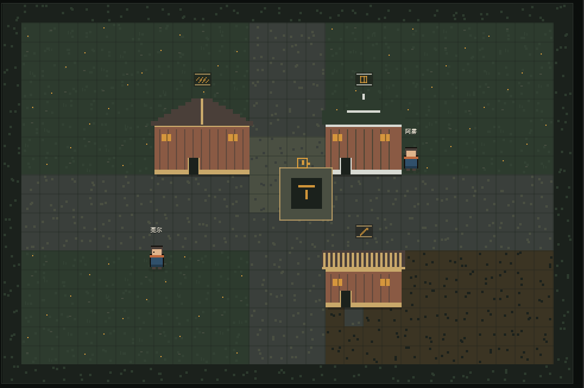
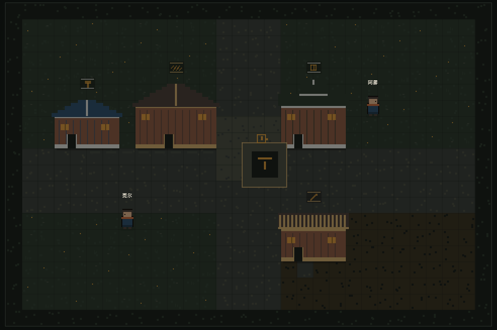

# 小溪 (Xiaoxi)

**一个采用「台前语音快环 (System 1) + 幕后 Agent 慢环 (System 2)」双系统架构的个人中文语音 Agent，
外加一座像素小镇——你的 Agent 在里面真的走路、干活、交付。**

核心解决两个工程痛点：复杂工具调用**阻塞语音流**，长期记忆检索**诱发幻觉编造**。
再加一个：**Agent 干活过程不可见**——督办台账是一张表，不是一个人在那儿忙。

## ✨ 核心特色

**⚡ 快慢双环解耦 (Dual-Loop & Orchestrator-Workers)**
- 台前快环：流式 ASR → 对话管理 → 流式生成，只做日常对话与意图路由；识别到复杂委托立即语音确认、异步卸载，**语音流全程零阻塞**。
- 幕后慢环：任务规划后分发给独立 Worker 异步执行（CLI / HTTP / MCP / HITL 四种适配器），遥测 (Telemetry) 全程观测；检测到步骤空转或连续异常自动熔断 (Circuit Breaker)。
- 自进化护栏 (Feedback-Driven Guardrails)：L1 确定性规则 + L2 启发式准则双层评估器；人工驳回并留下反馈后，自动归纳出新准则注入后续 Prompt。

**🧠 置信度分级记忆 (Confidence-Tiered Memory)**
- 检索结果按三档确定性装配进 System Prompt：【你明确说过的】可直接当事实、【我的推测】必须留余地、【我不确定的】先求证再用——从 Prompt 层约束幻觉，而不是指望模型自觉。
- 检索为空时显式注入负向约束，禁止用预训练常识脑补共同经历；删除是 SQLite 物理硬删除，没有"删了但索引还在"的记忆幽灵。

**🔌 可插拔与心流防打扰 (Pluggable & Focus-Aware)**
- 新增一种干活 Agent 只需两步：YAML 花名册加一行 +（可选）实现一个适配器接口，调度核心零改动；角色 / 记忆策略 / 节奏 / 花名册全部热重载 (Hot-Reload)。
- 你正在打字时，后台完结的任务只亮胶囊呼吸灯，不出声、不抢焦点。

**🏘️ 像素世界：台账的具身投影 (Pixel World as a Read-Only Projection)**



- 后台派一单活，小镇里的她会**起身走向对应铺子、机器开工、干完出来交付**——不是播放动画，每个动作都能追到台账里一个真实字段。
- 世界是**纯投影**：只读 REST + WS `commission_update`，不写台账、不 accept/submit。渲染换掉不影响逻辑，逻辑换掉不影响渲染。
- **不撒谎**这条是硬约束：没发生的事不写进日报，没有真实数据就不摆卡片。工具真失败时显示失败，不美化。
- 24 色调色板 + 像素字体 + 昼夜（纯渲染态），全部有门禁：越界取色直接红。



## 🏗️ 系统架构

```text
        config/*.yaml   角色契约 · 记忆策略 · 节奏 · Worker 花名册（热重载）
              │
              ▼
┌──────────────────────────────────────────────────┐
│ 台前快环 (System 1) · 实时语音                   │
│                                                  │
│   麦克风 → VAD 断句 → 流式 ASR                   │
│                 ↓                                │
│   对话管理 + 分级记忆检索 (SQLite 混合检索)      │
│     ├─ 日常对话 → 流式生成 → 情感 TTS → 立绘     │
│     └─ 复杂委托 → 语音确认 → 异步卸载至慢环      │
└──────────────────────────────────────────────────┘
                       ▼
┌──────────────────────────────────────────────────┐
│ 幕后慢环 (System 2) · Orchestrator-Workers       │
│                                                  │
│   任务规划 → Worker 异步执行 (CLI/HTTP/MCP/HITL) │
│     ↑                                            │
│   遥测监控：步骤空转 / 连续异常 → 自动熔断       │
│     ↓                                            │
│   L1/L2 评估器：驳回反馈 → 自动归纳新准则        │
└──────────────────────────────────────────────────┘
                       ▼
┌──────────────────────────────────────────────────┐
│ 多模态呈现层                                     │
│   情绪标签 → 可控音色 TTS + 口型 / 表情 / 视线   │
│   焦点感知节流 → 胶囊呼吸灯 / 任务抽屉 / 图谱    │
└──────────────────────────────────────────────────┘
                       │
                       ▼  只读投影（不写台账，不 accept/submit）
┌──────────────────────────────────────────────────┐
│ 像素世界 (Pixel World) · /world                  │
│   REST 全量 + WS commission_update 增量          │
│   台账状态 → 她起身 / 进屋 / 开工 / 交付         │
│   渲染层可整块替换，世界逻辑不动                 │
└──────────────────────────────────────────────────┘
```

性格不是一句人设，而是四层契约（身份 / 稳定倾向 / 互动方式 / 可变状态），每条带正例、反例与边界，并写死一条优先级：**性格与事实准确性冲突时，准确性优先**。记忆分四类（`fact` / `episode` / `todo` / `self_state`），行为随配置改变，不改代码。

## 🚀 30 秒快速开始

```powershell
uv venv
uv pip install -r requirements.txt
Copy-Item .env.example .env      # 可选：填入 LLM_API_KEY 接入真实模型
python scripts/run.py            # 打开 http://127.0.0.1:8000
```

**没有 API Key 也能跑通全链路**：自动进入离线 Mock 模式——LLM 返回占位文本、TTS 静音输出，而记忆读写、语音链路、打断、任务调度照常运转，零成本体验完整交互。

```powershell
python scripts/test_core.py      # 离线契约检查（不需要网络 / API Key）
npm test                         # 前端单测（无浏览器依赖）
```

**连同像素小镇一起跑：**

```powershell
cd pixel-world
npm install
npm run dev                      # http://127.0.0.1:5188（独立沙盒）
npm test                         # 221 项纯逻辑测试，不需要浏览器
```

同源部署时不用单独起前端：服务端检测到 `pixel-world/dist` 就把它挂在 `/world`。

更多测试与评测见 [docs/TESTING.md](docs/TESTING.md)，施工细节见 [docs/README_EXTENDED.md](docs/README_EXTENDED.md)，
像素世界单独一份：[pixel-world/README.md](pixel-world/README.md)。

## 🧪 工程实测：与幻觉的几轮交手

**1. 模型选型：为什么弃用 `stepaudio-2.5-chat`，锁定 `step-3.7-flash`**
用诱导性提问探针（询问从未发生过的共同经历）对比：`stepaudio-2.5-chat` 幻觉率 **3/3**——即便 System Prompt 写明"你没有任何相关记忆"，Audio-Chat 微调出的"接话顺从"倾向仍会顺口编造细节；`step-3.7-flash` **0/3**，严格遵守负向约束承认"无相关记录"。性格改由 TTS 的 `instruction`（自然语言情绪指令）承载：音色固定，情绪可变。

**2. 空检索必须显式声明，不能只传空列表**
消融实验发现：只传空记忆列表时，LLM 仍有很高概率依赖常识脑补。工程上必须在 Prompt 注入显式空状态——未检索到 → 直接向用户求证，严禁顺从提问编造事实。

**3. Few-Shot 示例必须每轮都带情绪标签**
下游 TTS 音色切换与 Avatar 表情状态机依赖句首 `[情绪]` 标签。仅靠指令约束时，多轮长对话（>5 turns）后会出现指令遗忘；必须在示例集中让每一轮 Assistant 回复都携带合法标签，用 In-Context Learning 维持长程格式对齐。

**4. 延迟地板（诚实数据）**
级联管线 ASR → LLM → TTS 的首字延迟地板约 2s（空提示词也要 1.95s），短回复首音 ~3.5s、长回复 5.8s。要压进 500ms 需要原生全双工语音模型或 ASR Partial 抢跑。

## 🛠️ 扩展与已知限制

**两步接入一个 Worker**
1. 在 `config/agents_roster.yaml` 加一行：`id` / `adapter`（`manual` / `cli_subproc` / `http_api` / `mcp`）/ 能力标签。
2. 内置适配器不够用时，继承适配器基类实现 `prepare_context / execute / cancel` 并注册即可——调度核心零改动，这条有测试背书（Mock 适配器跑通全程）。

**已知限制**
- 级联管线首字延迟地板约 2s，见上文诚实数据。
- 三个内置 Worker 默认 `manual`（Human-in-the-Loop）：只生成结构化任务简报、在前端抽屉等待人工回填，便于无外部工具环境下验证闭环；生产环境换成 `cli_subproc` / `mcp` 即可，无需改 Python。
- 混合检索为字符 n-gram TF-IDF + 重要性 / 时近性重排，在百至千条个人记忆规模下零外部向量库依赖；上万条长文档建议在检索层加稠密向量。
- 语音打断依赖浏览器 WebRTC AEC，扬声器大音量外放可能回声自激，建议戴耳机。

**像素世界目前不做的**
- **世界内验收/回写**：世界是纯投影，验收、打回、换将这些动作仍回主界面点。后端写路由已存在，缺的是产品决策与世界端动作。
- **多角色**：一座铺子一个店主还没做，现在 7 个 Agent 的活归她一个人干，台账一忙就会露怯。
- **真实的工具失败**：工坊有 `overheating` 态，但没有真实工具时伪造失败就是假动作，所以恒不触发。
- **造物主的 LLM 生成**：扩建走的是固定样板 + 槽位选择，生成层留着没做。
- 世界端 e2e 的 `ledger.connected` 直接留证、`toAltar` 采集窗口两处证据缺口在跟（见仓库 issue #9 / #10）。

设计与协议细节：[docs/PROTOCOL.md](docs/PROTOCOL.md) · [docs/EXECUTIVE_SECRETARY_V3.md](docs/EXECUTIVE_SECRETARY_V3.md) · [docs/AGENT_PLAYBOOK.md](docs/AGENT_PLAYBOOK.md)
