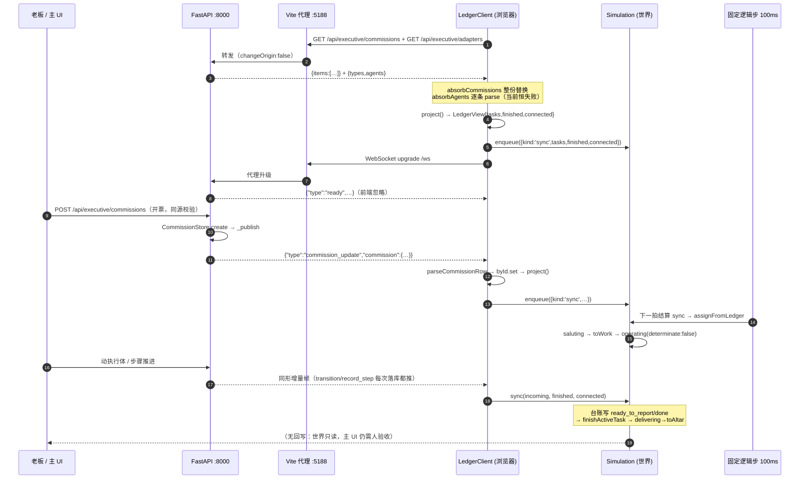

# 像素世界 × 主仓库 Agent 台账：集成状态核验

> **⚠️ 过期快照（2026-10-24 回填标注）**：本文核验基线是 2026-10-19 的 HEAD `9cd0c5a`。其后文中多条「缺失 / 仅形状」结论已被 master 修复（多角色、存档、调试面板、strengths、心跳等；逐项对账未做）。**现状以代码与门禁命令输出为准**，本文只作历史存档；现行交付状态见 `docs/DELIVERY_PLAN_20261024.md`。

> **核验方式：静态代码核验，未运行验证。**
> 本次未启动 8000 / 5188，未执行构建、单元测试、浏览器冒烟，也未写入任何源码/配置/既有文档（按分工，运行验证归 QA，见 `docs/RUNTIME_VERIFICATION.md`）。本文所有"真实实现 / 仅 Mock / 缺失"的判断来自源码阅读；运行时是否真的联通以 QA 实测为准。
>
> **核验基线**：分支 `feat/pixel-world-oracle-world`，HEAD `9cd0c5a feat(world): 像素世界接上真实督办台账`。仓库根 `D:\project\neurosama`，文中路径均相对该根目录。

---

## 一、结论摘要

1. **台账→世界的下行链路是真实现，且契约在协议里有正式定义。** 后端在 startup 订阅台账写库事件（`server/app.py:1346-1351`，`server/interaction/threads.py:703-733`），每次落库后广播 `{"type":"commission_update","commission":{…}}`（`server/app.py:966-984`、`976-984`）；前端先 REST 拉全量、再挂 `/ws` 吃增量、断线回退 4s 轮询并重连（`pixel-world/src/world/ledger.ts:55-61`、`74-88`、`106-135`）。协议 `docs/PROTOCOL.md:348-354` 明确"commission 就是 GET items 元素本身，不另立字段"。
2. **"外部 Agent 双向消息"目前只有形状，没有运输层。** `bridge.ts` 定义了两个方向的消息与转换，但 `Bridge` 类在整个 `src/` 里从未被实例化；上行 `emit()/drain()` 只有单测调用（`bridge.ts:35-59` vs `test/surface.test.ts:116-141`）。生产代码里外部 Agent 只能通过 `window.Oracle.feed()` 注入（`scenes/SandboxScene.ts:214-217`、`238`），而 LEDGER 浏览器冒烟用的是 `window.Oracle.pushLedger()` 合成帧（`scripts/smoke.mjs:74-94`），**不是**服务端真实推送。
3. **最大契约缺陷（P0）：`/api/executive/adapters` 的字段与前端 `AgentRow` 对不上。** 后端 bindings 元素是 `{"agent_id","name",…adapter描述}`（`server/assistant/executive_api.py:118-122`、`server/assistant/executive.py:244-258`），没有任何 `id`、没有 `strengths`；前端 `parseAgentRow` 要求 `row.id`（`projection.ts:141-149`），`ledger.ts:159-171` 逐条 catch 吞掉 → 真机上 `agents` **恒为空数组**。后果：① 世界显示原始 `agent_id` 而不是"真机 Claude"这类名字（`projection.ts:82`）；② `kindForAgent` 拿不到 strengths，三类活只能靠 title 关键词硬猜（`projection.ts:106-116`），可能派错铺子。单测喂的是手写 `AGENTS` 数组（`test/ledger.test.ts:31-35`），所以测试全绿、真机退化。
4. **映射点确实是唯一且纯函数，但优先级逻辑是死代码。** `projection.ts` 是台账字段↔世界事实的唯一映射（`projection.ts:68-91`、`119-149`），状态集与后端 7 状态对齐（`projection.ts:63-66` vs `threads.py:517-519`）。但：① `pickActive()` 的 blocked>running>briefing 优先级无人消费——`ledger.ts:173-184` 只把 `tasks` 传给世界，`projection.active` 只在测试里被读（`test/ledger.test.ts:79-103`）；② `simulation.ts:345-350` 取的是"第一条 assigned"，实际是插入序；③ 未知状态与 `drafting` 被直接丢弃（`projection.ts:73-75`），与 `PROTOCOL.md:331`"未知状态降级为进行中"不一致。
5. **世界侧语义是对的：完成权归台账、不编进度、撤单停手、离线照常过日子。** `sync` 是唯一替换式命令（`simulation.ts:266-326`）；台账活 `determinate:false`、不画假百分比（`simulation.ts:684-691`）；上游撤单则停手熄火（`simulation.ts:366-382`）；台账说收工才走交付（`simulation.ts:729-752`）；离线只改状态行不抛错（`simulation.ts:276-281`、`ledger.ts:84-87`、`SandboxScene.ts:370`）。`?ledger=off` 显式降级纯沙盒（`SandboxScene.ts:118-120`）。
6. **健壮性四个缺口**：① 无心跳，WS 处于 OPEN 但服务端漏推/订阅失效时永不刷新（`ledger.ts:58-61` 只在 WS 非 OPEN 时轮询，协议 `PROTOCOL.md:354` 又规定不补发）；② fetch 无超时、无并发保护，可重叠挂起（`ledger.ts:137-141`）；③ REST 默认 `limit=50` 被前端当全量（`executive_api.py:52`、`threads.py:746`），而"不在快照里"在 `simulation.ts:284-305` 会被当撤单；④ `refresh` 用 `Promise.all` 同时拉 commissions 与 adapters，adapters 一侧失败会连累整次刷新（`ledger.ts:77-86`）。
7. **世界不回写台账：设计如此，但要在 1.0 前确认。** 前端全仓没有写请求（`ledger.ts:137-141` 只有 GET），交付只发生在世界内部，主 UI 仍需人验收；pixel-world README 明确把"回写/世界内验收"列为下一步（`pixel-world/README.md:101-108`、`116-118`），后端写路由已就位（`executive_api.py:78-107`）。接不接是产品决策，不是代码缺陷。
8. **样品 1.0 够用度**：后端推送链路、前端全量+增量+断线兜底、台账→世界状态机、`?ledger=off` 降级，四块静态判断**够用**。必须补的是：adapters 字段契约（P0-1）、周期对账/心跳（P0-2）、一次"真帧"端到端验证（P0-3）、固定 `npm run dev` 启动链路（P0-4——`vite preview` 没有 `/api` `/ws` 代理，`package.json:8-10`、`vite.config.ts:7-15`）。

---

## 二、前后端字段对照表

### 2.1 `GET /api/executive/commissions` → `CommissionRow`

后端：`executive_api.py:51-53` 返回 `{"items":[…]}`；元素来自 `threads.py:740-751`（`SELECT *` 后 `_project`，`threads.py:595-606`）。
前端：`ledger.ts:143-157` 读 `items`，`projection.ts:119-139` 逐字段解析。

| 前端字段（读取点） | 后端字段（来源） | 判定 | 备注 |
|---|---|---|---|
| `items`（`ledger.ts:145`） | `{"items": …}`（`executive_api.py:52-53`） | ✅ 一致 | — |
| `id`（`projection.ts:128-129`） | `commissions.id`（`threads.py:547`） | ✅ 一致 | 缺 id 直接拒绝 |
| `title`（`projection.ts:133`） | `commissions.title` | ✅ 一致 | — |
| `agent_id`（`projection.ts:134`） | `commissions.agent_id` | ✅ 一致 | 但花名册侧无匹配（见 2.2） |
| `status`（`projection.ts:135`） | `commissions.status` | ✅ 字段一致 | 取值集合差异见 2.5 |
| `step_idx`（`projection.ts:130-136`） | `commissions.step_idx` | ⚠️ 读到但丢弃 | `ledger.ts:175-181` 不传给世界，世界用不到 |
| `blocked_question`（`projection.ts:137`） | `commissions.blocked_question` | ⚠️ 读到但丢弃 | 同上；`blocked` 的"请示"在世界里没有任何表现 |
| —（忽略） | `thread_id`,`brief`,`retry_count`,`delivery`,`audit`,`packet`,`rubric_ids`,`created_at`,`updated_at`,`closed_at` | ✅ 允许忽略 | 与 `projection.ts:10`"多余字段一律忽略"一致；形状见 `PROTOCOL.md:334-340` |

### 2.2 `GET /api/executive/adapters` → `AgentRow`

后端：`executive_api.py:118-122` 返回 `{"types":[…], "agents":[…]}`；`agents` 元素由 `executive.py:247-258` 组装：`{"agent_id": id, "name": name, **adapter.describe()}`。
前端：`ledger.ts:159-171` 读 `agents`，`projection.ts:141-149` 解析。

| 前端字段 | 后端实际字段 | 判定 |
|---|---|---|
| `id`（`projection.ts:144-145`） | `agent_id`（`executive.py:257`） | ❌ **命名不一致，导致整条被丢弃** |
| `name`（`projection.ts:149`） | `name`（`executive.py:257`） | ✅ 一致（但因上一条进不来） |
| `strengths`（`projection.ts:146-148`） | **不存在** | ❌ **缺失**（花名册里有，`config/agents_roster.yaml:52`、`66`、`80`、`102`、`124`、`147`、`170`，但 API 不返回） |
| 未知 `adapter` 等描述字段 | `adapter`/`error` 等 | ✅ 前端忽略 |

### 2.3 WS `commission_update` → `LedgerClient`

| 前端 | 后端 | 判定 |
|---|---|---|
| 连接 `ws(s)://${location.host}/ws`（`ledger.ts:108-109`） | FastAPI `@app.websocket("/ws")`（`app.py:1008-1021`） | ✅ 路径一致（经 vite 代理，`vite.config.ts:15`） |
| `message.type === 'commission_update'`（`ledger.ts:120`） | `{"type":"commission_update"}`（`app.py:975`、`PROTOCOL.md:348-350`） | ✅ 一致 |
| `message.commission` → `parseCommissionRow`（`ledger.ts:121`、`93`） | `{"commission": <GET items 元素>}`（`app.py:975`；`_publish` 取 `self.get()`，`threads.py:719-733`） | ✅ 一致（与 REST 同形，前端无需第二套映射） |
| 其它事件类型全部忽略（`ledger.ts:120` 提前 return） | `/ws` 同时承载语音事件（`app.py:1049-1119`） | ✅ 只读监听安全（世界不发任何帧） |

### 2.4 外部 Agent 消息（bridge.ts）vs 后端 Worker/台账事件

| bridge 方向 | bridge 形状（`bridge.ts`） | 后端是否存在同构事件 | 判定 |
|---|---|---|---|
| 下行 `task.assigned` | `{type,taskId,taskKind,summary}`（`:13-19`） | 无。台账只有 `commission` 行（title/brief/status/agent_id），没有 `taskKind`/`summary`，也没有"派给世界"的事件类型 | ❌ 不同构 |
| 下行 `task.completed` | `{type,taskId}`（`:20-23`） | 无。台账用 7 状态迁移表达（`running→auditing→ready_to_report→done`，`threads.py:520-527`），没有 completed 二值事件 | ❌ 不同构 |
| 下行 `world.weather` | `{type,weather}`（`:24-27`） | 后端没有天气概念/天气事件 | ❌ 不同构 |
| 上行 `task.accepted/refused/delivered/world.rained` | `:29-33` | 后端无对应事件；世界也从未 emit（仅 `test/surface.test.ts:138-141`） | ❌ 缺失 |
| 转换 `toWorldCommand` | `:62-74` | 有意丢弃 `taskId`：世界自己的沙盒任务用 `t{n}` 编号（`simulation.ts:484-498`），台账任务用 `commissionId` | ⚠️ 外部 Agent 无法用自己 taskId 关联交付回执 |

### 2.5 状态集合对照

| 状态 | 后端（`threads.py:517-519`） | 前端 projection（`projection.ts:63-66`） | 判定 |
|---|---|---|---|
| `drafting` | 有 | 不处理（刻意，`test/ledger.test.ts:90-97`） | ✅ 合理忽略 |
| `briefing` / `running` / `blocked` / `auditing` | 有 | `ACTIVE_STATUSES` | ✅ |
| `ready_to_report` / `done` | 有 | `FINISHED_STATUSES` | ✅ |
| 未知状态 | 协议要求"降级为进行中"（`PROTOCOL.md:331`） | 直接丢弃（`projection.ts:73-75`） | ❌ 与协议不一致（不报错，但也不显示） |
| `done` 唯一终态 | `TERMINAL=frozenset(('done',))`（`threads.py:519`） | 与 ready_to_report 一并当"已收工" | ⚠️ 世界在"待验收"阶段就交付，属于设计选择，需在协议/演示脚本里说清 |

---

## 三、三分类清单

> 每条都带 `文件:行号`。**"真实实现"= 生产代码路径可达且逻辑完整；"仅 Mock"= 只有形状/测试/注入钩子，真机走不到；"缺失"= 协议或 README 声称需要，但代码里没有。**

### 3.1 真实实现

| # | 能力 | 证据 |
|---|---|---|
| 1 | 后端台账写库后订阅并广播 WS 增量 | `threads.py:703-717`（subscribe）、`719-733`（_publish，事务外、异常吞掉）、`app.py:986-999`（线程安全切回主循环）、`966-984`（广播，旁路丢弃）、`app.py:1346-1351`（startup 挂订阅） |
| 2 | 前端 REST 全量 + WS 增量双来源 | `ledger.ts:74-88`（REST）、`91-100`（单帧增量）、`143-157`（整份替换，防已删单挂住世界）、`106-135`（WS） |
| 3 | 断线兜底：WS 未 OPEN 时 4s 轮询；close 后延时重连 | `ledger.ts:58-61`、`123-131`（`DEFAULT_POLL_MS=4000`，`:34`） |
| 4 | 离线降级：只标 connected=false，不抛错 | `ledger.ts:84-87`、`simulation.ts:276-281`、`SandboxScene.ts:370`（状态行"台账离线"） |
| 5 | 显式沙盒降级 `?ledger=off` | `SandboxScene.ts:118-120`；README 声明 `pixel-world/README.md:42` |
| 6 | 台账→世界唯一映射点（纯函数、可离线断言） | `projection.ts:68-91`、`119-139`、`141-149`；`types.ts` 无台账字段泄漏 |
| 7 | 状态机消费台账：替换式 sync、完成权归台账、撤单停手 | `simulation.ts:266-326`（sync 主体）、`:284-305`（收工/消失）、`:366-382`（撤单）、`:729-752`（交付） |
| 8 | 不编进度：台账活 `determinate:false` | `simulation.ts:684-691`；渲染侧 progress=null（`simulation.ts:190-198`） |
| 9 | 命令队列唯一入口 + 固定步长（100ms，可确定性回放） | `simulation.ts:163-165`（enqueue）、`:168-183`（每拍开头统一结算）、`SandboxScene.ts:31-32`（LOGIC_STEP_MS/MAX_STEPS_PER_FRAME）、`:165-179`（累加器驱动）；sim 内无 `Date.now/Math.random`（全文件 grep 为空） |
| 10 | 神谕关键词路由（世界自己的意图路由器，非 LLM） | `oracle.ts` 的 `parseOracle`；面板/按钮/终端都收敛到 `say()`（`oracle-panel.ts`、`SandboxScene.ts:184-198`） |
| 11 | 任务档位表：短活原地、长活进城 | `tasks.ts:9-25`；`simulation.ts:421-464` |
| 12 | bridge 消息形状 + 纯转换函数（单向可用） | `bridge.ts:13-33`（形状）、`:62-74`（转换）；单测 `test/surface.test.ts:116-135` |
| 13 | 协议契约本身（同形、旁路、不补发） | `docs/PROTOCOL.md:348-354`；写路由同源校验 `executive_api.py:17-29` |
| 14 | 后端写路由（开票/请示/验收/打回/交差/驱动） | `executive_api.py:55-62`、`72-107` |

### 3.2 仅 Mock（形状/测试/注入钩子，真机链路走不到）

| # | 能力 | 证据 | 真机影响 |
|---|---|---|---|
| M1 | 外部 Agent 下行入口 | `SandboxScene.feed()`（`:214-217`）+ `window.Oracle.feed`（`:238`）只是控制台钩子；无 postMessage / WS / 终端 transport；`Bridge` 类从未实例化（全仓 grep 仅 `test/surface.test.ts:131`、`138`） | 外部 Agent 现在无法真的把任务送进来 |
| M2 | 世界→Agent 上行回执 | `Bridge.emit/drain`（`bridge.ts:43-58`）生产代码零调用；`task.delivered/world.rained` 从未产生（仅 `test/surface.test.ts:138-141`） | 台账/主 UI 不知道世界已交付 |
| M3 | Agent 能力关键词分类的真实数据源 | 单测手写 `AGENTS`（`test/ledger.test.ts:31-35`），真实 `/api/executive/adapters` 不返回 id/strengths（`executive_api.py:118-122`、`executive.py:244-258`） | `agents` 恒空 → 分类退化到 title 关键词 |
| M4 | LEDGER 浏览器冒烟的"上游推送" | `smoke.mjs:74-94` 用 `window.Oracle.pushLedger()` 注入合成帧，注释也承认"等价于服务端真发了一帧"（`:72-73`）；`smoke.mjs:62-107` | 冒烟绿 ≠ 真 WS 推送通 |
| M5 | 外部 Agent 桥接的浏览器断言 | `smoke.mjs:241-252` 通过 `window.Oracle.feed` 注入，再数 `view().tasks` 长度 | 只证明转换+队列，不证明运输层 |
| M6 | 真实工具失败（overheating） | `tasks.ts:28-30` `shouldOverheat()` 恒 false；README 自述 `pixel-world/README.md:104-105` | 铺子"故障态"永不出现，演示别承诺 |
| M7 | `?ledger=on` 的可靠性背书 | README 声称"默认接台账"（`:42`），但只有 LEDGER 冒烟且是合成帧 | 需要真正的主服务运行验证（QA） |

### 3.3 缺失

| # | 缺失项 | 证据 | 说明 |
|---|---|---|---|
| X1 | **adapters 字段契约**（id/strengths） | 前端 `projection.ts:141-149`、`ledger.ts:159-171`；后端 `executive_api.py:118-122`、`executive.py:247-258` | P0，见 6.2 |
| X2 | **WS 周期对账 / 心跳（ping-pong）** | `ledger.ts:55-135` 全文无 ping/onopen/心跳；只有在 `!wsAlive()` 时轮询（`:58-61`） | WS OPEN 但漏推时世界永久停在旧状态 |
| X3 | **REST fetch 超时 / 并发保护** | `ledger.ts:137-141` 无 `AbortController`/timeout；`:58-61` 的 setInterval 可叠加在途请求 | 8000 半死时可堆积 |
| X4 | **外部 transport 层** | `bridge.ts:7-8` 注释"运输层在别处"；仓库内不存在该"别处" | 双向消息目前不可用 |
| X5 | **世界→台账写回/验收动作** | 前端零写请求（`ledger.ts:137-141` 仅 GET；全 src grep 无 `method:`/POST）；后端路由存在（`executive_api.py:78-107`） | README 列为下一步（`pixel-world/README.md:101-108`、`116-118`），1.0 需明确"不做" |
| X6 | **blocked 请示的世界表现** | `projection.ts:84` 保留 blockedQuestion，但 `ledger.ts:175-184` 丢弃，`simulation.ts:266-275` 的 sync 无此字段 | `blocked` 单会被当成"在跑"，她一直在铺子里冒烟 |
| X7 | **未知状态降级** | `projection.ts:73-75` 直接跳过 vs `PROTOCOL.md:331`"降级为进行中" | 新状态上线时世界静默丢单 |
| X8 | **`projection.active` 的消费** | 只被 `projection.ts:90` 构造、`test/ledger.test.ts:79-103` 断言；`ledger.ts:174-184` 不用 | blocked 优先=死代码 |
| X9 | **运行时 Schema 校验/异常隔离** | `toWorldCommand` 不校验枚举（`bridge.ts:66-73`）；`simulation.dispatch` 直接 `TASK_PROFILES[taskKind]`（`simulation.ts:414-420`）；`update()` 无 try/catch（`:168-183`） | 一条坏帧可让主循环每帧抛错 |
| X10 | **`/ws` 握手同源校验** | 只有 REST 写路由校验 origin（`executive_api.py:17-29`）；`/ws` 接受任意 origin（`app.py:1008-1011`） | 本地单用户风险低，但演示/联网前需知道 |
| X11 | **多 Agent/多角色** | 一人一单：`simulation.isFree()`（`:541-543`）；README 自述 `pixel-world/README.md:107` | 7 个 Agent 的活都归一个她，1.0 可接受 |

---

## 四、消息时序

### 4.1 真实主链路（REST 全量 + WS 增量，静态可证）



### 4.2 断开与降级路径

```text
[启动] start() ──► refresh() 成功 ──► connected=true
                        │失败（fetch 抛错/非 2xx）
                        ▼
                   connected=false（byId 不清空）──► publish ──► sync(connected=false)
                                                                    │
                                                                    ▼
                                                        只改状态行"台账离线"，早退

[WS] openSocket()
      ├─ message(type=commission_update) ─► applyPush ─► publish ─► sync
      ├─ close ─► connected=false + publish + setTimeout(pollMs) 后重连
      └─ error ─► connected=false（不重连，等轮询）

[轮询] setInterval(pollMs=4000)：仅当 ws.readyState !== OPEN 才 refresh()
       → 重连成功后停止刷新（⚠️ WS 活着但漏推时没有对账，见 X2）

[离线模式] URL ?ledger=off ─► 不创建 LedgerClient（SandboxScene.ts:118-120）
       → ledger.connected 恒 false → 状态行仍写"台账离线"（歧义，见 R10）
```

### 4.3 外部 Agent 链路（当前：形状存在，运输层缺失）

```text
外部 Agent ──(?)──► Bridge.feed(AgentToWorld) ──► takeInbox / toWorldCommand
                    ✗ 无 transport；Bridge 未实例化；只测于 test/surface.test.ts
外部 Agent ──► window.Oracle.feed(msg) ──► SandboxScene.feed ──► sim.enqueue
                    ✓ 可用（仅浏览器控制台/冒烟脚本）

世界 ──► Bridge.emit(WorldToAgent) ──► outbox ──► drain()
                    ✗ 生产代码零调用 → 外部 Agent 收不到任何回执
                    ✗ 台账 commission_update 不会转成 AgentToWorld（无适配层）
```

---

## 五、风险清单

| # | 等级 | 风险 | 证据 | 影响/触发条件 |
|---|---|---|---|---|
| R1 | **高** | adapters 契约不匹配 → 真机 `agents` 恒空 | 2.2 表；`executive_api.py:118-122`、`executive.py:257`、`projection.ts:141-149`、`ledger.ts:159-171` | 演示中 Agent 名显示 `scribe` 而非"笔录官"；分类只靠标题关键词，可能把代码活派进写作铺 |
| R2 | **高** | WS 活着但无推送时永不刷新 | `ledger.ts:58-61`；`PROTOCOL.md:354`"不补发" | 服务端订阅失效、帧被代理吞、或推送时连接瞬间不在 → 世界停在旧状态且状态行仍显示"台账在线" |
| R3 | **高** | 外部 Agent 双向链路不可用 | `bridge.ts:35-59` 无实例化；`smoke.mjs:74-94` 合成帧 | "接上真实 Agent"目前只完成了台账单向投影；演示不能说"Agent 能驱动世界" |
| R4 | 中 | 世界不回写台账 / 无验收回执 | 前端零写请求（`ledger.ts:137-141`）；`pixel-world/README.md:101-108` | 世界交付后主 UI 状态仍是 ready_to_report，演示需要人工去主 UI 点验收 |
| R5 | 中 | 坏消息可打断主循环 | `bridge.ts:66-73` 不校验枚举；`simulation.ts:414-420` 直取 `TASK_PROFILES[taskKind]`；`update()` 无 try/catch（`:168-183`） | feed 一条 `taskKind:"bogus"` → TypeError → Phaser update 每帧抛错 |
| R6 | 中 | blocked 单被当成"在跑"、优先级死代码 | `projection.ts:64`、`:84`、`:94-103`；`ledger.ts:174-184`；`simulation.ts:345-350` | 上游等她请示的单，她在铺子里一直冒烟；世界不表达"在等老板" |
| R7 | 中 | 未知状态静默丢单（违反协议降级要求） | `projection.ts:73-75` vs `PROTOCOL.md:331` | 后端加状态/灰度字段后，世界看不到该单，且无日志 |
| R8 | 中 | REST 默认 50 条被当全量；"不在快照"=撤单 | `executive_api.py:52`、`threads.py:746`；`simulation.ts:284-305` | 督办累计 >50 时，老单被误判撤销；长期演示库需要清库或前端带 limit |
| R9 | 低-中 | 刷新无超时/可重叠；adapters 失败连累 commissions | `ledger.ts:77-86`、`:137-141` | 8000 半死时挂起请求堆积；adapters 500 会让整次刷新判离线 |
| R10 | 低 | 离线每 4s 记一条 warn；`?ledger=off` 仍显示"台账离线" | `ledger.ts:58-61` + `simulation.ts:277-281`；`SandboxScene.ts:370` | 事件栏刷屏；离线演示被误读成"台账坏了" |
| R11 | 低 | 共享语音 `/ws` 通道且握手无同源校验 | `app.py:1008-1021`；语音事件解析 `app.py:1063-1073` | 当前世界只读安全；未来若在 `/ws` 发消息，字段不对会被当成 text turn 触发对话 |
| R12 | 低 | 每个像素世界页签建一条语音 session | `app.py:1013`；`server/memory/store.py:1409-1411`（`INSERT OR REPLACE INTO sessions`） | 反复刷新页面会往 sessions 表灌空会话，干扰主 UI 会话列表/统计 |

---

## 六、样品 1.0 最小集成项

### 6.1 已经够用（1.0 不需要改）

| 项 | 依据 |
|---|---|
| 台账→世界的真实推送下行（含同形契约） | `app.py:966-999`、`1346-1351`、`threads.py:703-733`、`PROTOCOL.md:348-354` |
| 前端 REST 全量 + WS 增量 + 断线轮询/重连 | `ledger.ts:55-135` |
| 台账→世界唯一映射与状态机语义（完成权、撤单、不编进度） | `projection.ts`、`simulation.ts:266-326`、`:684-691`、`:729-752` |
| 离线/纯沙盒降级 `?ledger=off` | `SandboxScene.ts:118-133`、`:370` |
| 命令队列唯一入口 + 固定步长 + 确定性（无内部时钟） | `simulation.ts:163-183`、`SandboxScene.ts:31-32`、`:165-179` |
| 逻辑层单测覆盖投影/sync 语义（15 项） | `test/ledger.test.ts:31-215`（静态读取，未运行） |

### 6.2 必须补（P0，1.0 前）

| # | 项 | 最小改法（供实现方参考，本次不改代码） | 验收方式 |
|---|---|---|---|
| P0-1 | 修 adapters 字段契约（X1/R1） | 二选一：① 前端 `projection.ts:141-149` 兼容 `agent_id`，并从别处取 strengths；② 后端 `executive.py:247-258` 的 binding 增补 `strengths`（只回关键词，不泄露配置值），前端按 `id` 读。注意后端约定"只回类型名"（`PROTOCOL.md:460`），②需要协议同步 | 打开 `?ledger=on`，控制台读 `Oracle.view()` 与状态行：Agent 名应为中文花名册名；派一条"实现爬虫"应进接代码活的铺子 |
| P0-2 | 周期对账 / 心跳（X2/R2） | `ledger.ts:start()` 增加"无论 WS 状态每 10-15s 一次 refresh"的慢对账（或 WS 层 ping/pong）；对账成功即覆盖 byId | 起 8000 → 起 5188 → 停 8000 → 再起；世界应在 ≤15s 内从"离线"回到"在线"并补回漏掉的单 |
| P0-3 | 一次"真帧"端到端验证（M4/R3） | 不用 `pushLedger`：主 UI 真实开票 → 世界动 → 主 UI `accept` → 世界交付。由 QA 在 `RUNTIME_VERIFICATION.md` 记录命令/时间/截图 | 主 UI 派单后世界 `saluting/toWork/operating`；`accept` 后世界 `delivering→toAltar`；全程 `console` 无 JS 报错 |
| P0-4 | 固定演示启动链路 | 演示只走 `npm run dev`（`package.json:8`）；`vite preview`（`:10`）没有 `/api` `/ws` 代理（`vite.config.ts:7-15` 只配 `server.proxy`）。把"先 8000 再 5188、`?ledger=on` 时断言状态行为台账在线"写进 DEMO_SCRIPT、或在 `preview.proxy` 补同款代理 | 按 DEMO_SCRIPT 冷启动一遍，观众席第一屏能看到"台账在线" |

### 6.3 建议补（P1，可与 1.0 并行）

| # | 项 | 理由 | 验收方式 |
|---|---|---|---|
| P1-1 | blocked 的世界表现（X6/R6） | 现在"要请示"的单被当在跑，演示上讲不通 | 造一条 `blocked` 单：世界不应进铺子冒烟，应有"等请示"的可见提示（气泡/状态行） |
| P1-2 | 外部 feed 运行时校验 + 命令异常隔离（X9/R5） | 一条坏帧不应打断 60fps 主循环；TS 类型在运行时不存在 | `Oracle.feed({type:'task.assigned',taskKind:'bogus',…})`：世界不崩、只记一条 warn |
| P1-3 | 未知状态降级为"进行中"（X7/R7） | 与 `PROTOCOL.md:331` 对齐，避免后端演进时静默丢单 | projection 单测补一条未知状态用例 |
| P1-4 | 让 `projection.active` 真正参与派活，或删掉（X8/R6） | 否则 blocked 优先规则是"看起来有、实际没有" | 同时有 running+blocked 两单时，派单顺序符合 `pickActive` 注释 |
| P1-5 | REST 带 `limit` 或对"不在快照"更保守（R8） | 长库演示会被 50 条截断误伤 | 台账 >50 条时世界仍只撤真正消失的单 |

### 6.4 明确不做（1.0 之外，需在演示脚本/FAQ 里声明）

| 项 | 依据 |
|---|---|
| 世界内点铺子验收/打回、世界回写台账 | `pixel-world/README.md:101-108`、`116-118` 列为下一步；本次以 `executive_api.py:78-107` 路由为未来接口 |
| 外部 Agent 的真实 transport（postMessage/WS/终端） | `bridge.ts:7-8` 只承诺形状；1.0 如需要，另立任务并先定协议（不得自造 WS 事件，`AGENTS.md:7`、`PROTOCOL.md:348`） |
| 多角色/一 Agent 一人 | `pixel-world/README.md:107`；`simulation.ts:541-543` |
| 真实工具失败（overheating） | `tasks.ts:28-30`；`pixel-world/README.md:104-105` |
| LLM 造物主 | `pixel-world/README.md:106` |

---

## 附：核验方法与证据边界

- **静态证据命令**（可复现，均为只读）：
  - `git log --oneline -5` / `git status --short`
  - 前端：`read`/`grep` 于 `pixel-world/src/{world,scenes,ui}/*.ts`、`pixel-world/test/*.ts`、`pixel-world/scripts/smoke.mjs`、`pixel-world/vite.config.ts`、`pixel-world/package.json`
  - 后端：`grep -n "commissions|commission_update|executive" server/*.py`，精读 `server/assistant/{executive_api,executive,dispatcher}.py`、`server/interaction/threads.py`、`server/app.py:966-1021,1346-1351`
  - 协议：`docs/PROTOCOL.md:331-354,458-460`
- **未验证（明确留给 QA / task-2）**：
  1. `/api/executive/adapters` 在当前工作区进程内的实际返回体（本文按唯一实现源静态推断）；
  2. `/ws` 经 Vite 8.3.4 代理（`ws:true`）的实际升级与帧投递；
  3. LEDGER 浏览器冒烟是否真的连通 8000（脚本本身用合成帧，见 M4）；
  4. `?ledger=on` 下 4s 轮询与重连的真实时序；
  5. 真实督办从主 UI 派出→世界运转→验收的完整时序。
- **未改动**：本文只新增本文件；未 commit/checkout/stash/reset，未改源码/配置/既有文档，未启动任何服务或端口。
