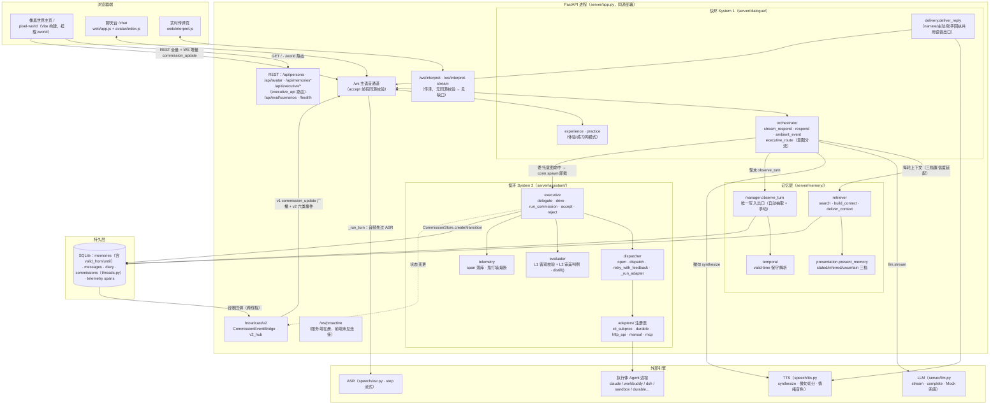
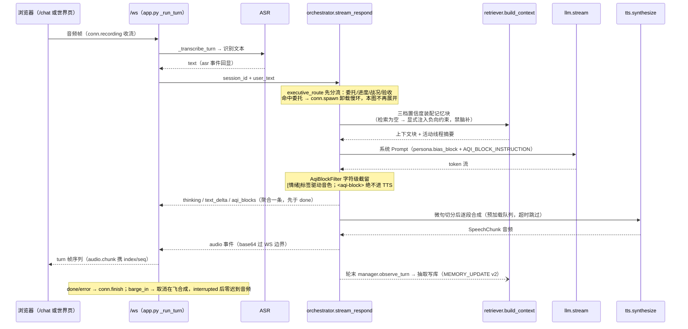
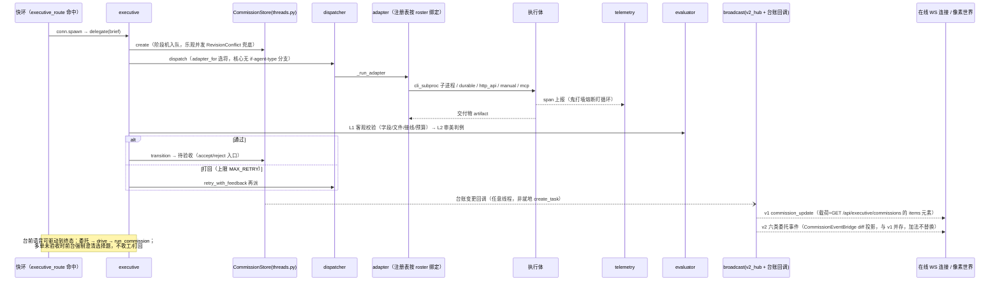
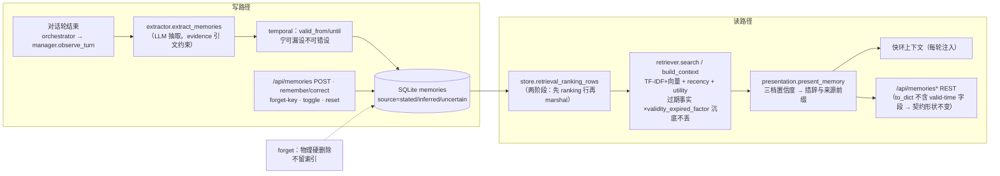
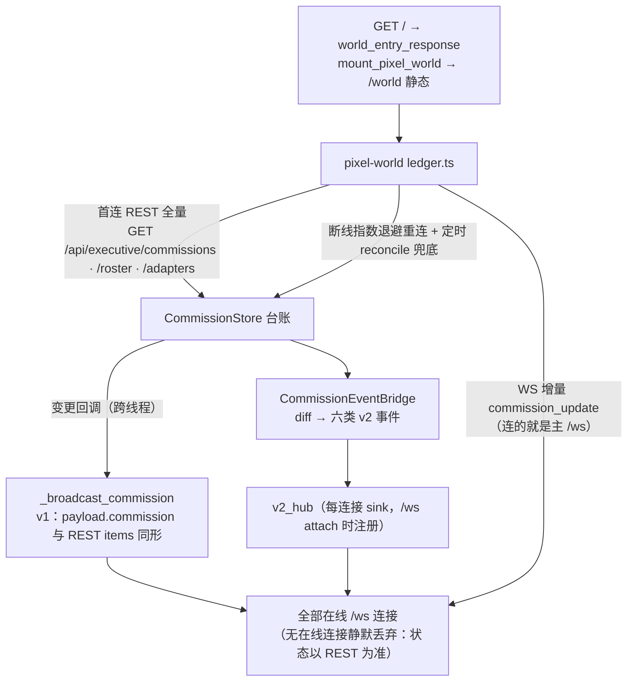

# 现状架构图与数据流图（代码核验版）

**口径**：本文件只画**当前运行态**，每一条边都在 2026-10-29 对 HEAD `ddec3b7` 从代码核过
（证据锚见文末表格与核对命令）。目标态/提案态一律不混入这里 ——
像素世界 13 态规格图在 `docs/ARCH_V2_DIAGRAM.md`，其 v2 事件标注「提案，未生效」，
与本文件是两份东西，不要互相引用为现状。

锚点纪律（AGENTS.md 写数字判据）：正文只写**符号名**不写行号（行号会漂移）；
必须引用行号处给「2026-10-29 + 符号」双锚，并附核对命令。

---

## 图 1 · 系统架构总览



要点（均为已核验设计约束）：快环内**零阻塞调用**，重活经 `conn.spawn` 异步卸载到慢环；
新增 Worker 只改 `config/agents_roster.yaml` 与适配器，调度核心零改动；
无 API Key 时 `LLM._mock` 自动兜底，全链路可跑。

---

## 图 2 · 快环一轮语音往返（System 1 数据流）



主动开口支线：`ambient_event`（空闲退避 + 冷启动破冰）与 app.js 45s 心跳驱动的
`proactive_check` 走同一 `deliver_reply` 语音出口，复用打断与轮次围栏。

---

## 图 3 · 慢环一单委托（System 2 数据流）



---

## 图 4 · 记忆层读写环



设计红线在图上的落点：三档置信度装配、空检索负向约束在图 2；硬删除在本图 `DEL`；
快环零阻塞在图 2 的 `conn.spawn` 卸载点。

---

## 图 5 · 广播与像素世界投影



---

## 证据锚（关键边 → 可核对的符号）

| 边 | 锚（2026-10-29 核对，符号名为准） |
|---|---|
| /ws accept 前同源校验，拒绝→HTTP 403 | `server/app.py` 主 websocket handler 头部（netloc 比对） |
| /ws/proactive、/ws/interpret* 无同源校验（缺口 B-1/B-3） | `server/speech/interpretation.py`、`stream_interpretation.py` 内 `origin` 0 次 |
| 委托意图 spawn 卸载 | `app.py` `_run_turn` 内 `conn.spawn(_executive_delegate(...))`；`orchestrator.executive_route` |
| 快环一轮链 | `orchestrator.stream_respond`（build_context / llm.stream / tts.synthesize / AqiBlockFilter 各调用点） |
| 轮末抽取唯一出口 | `manager.observe_turn` → `extract_memories`；MEMORY_UPDATE 发在该出口（`manager.py` §5.6 注释） |
| CommissionStore 6 阶段 + 乐观并发 | `interaction/threads.py` `CommissionStore.create/transition`、`RevisionConflict` |
| 核心无 agent-type 分支 | `dispatcher.adapter_for` 经注册表取适配器（V3 有测试背书，见 TASKS V3 段） |
| v1 广播与 REST 同形 | `app.py::_broadcast_commission` docstring 与实现 |
| v2 并存是加法 | `app.py` §25 注释「与 v1 commission_update 并存」；`broadcast/v2.py::CommissionEventBridge` |
| 世界投影只读台账 | `pixel-world/src/world/ledger.ts`（REST 全量 + WS 增量 + reconcile） |
| 主页=世界，旧聊天页 /chat | `app.py` `index()` docstring、`mount_pixel_world` |

### 核对命令（重跑即得现态，不依赖本文）

```bash
# WS 端点全集与 origin 覆盖
Select-String -Path server/app.py -Pattern '@app\.websocket' -Context 0,18 | Select-String 'origin'
# 快环链符号
Select-String -Path server/dialogue/orchestrator.py -Pattern 'def (stream_respond|respond|ambient_event|executive_route)|build_context|llm\.stream|tts\.synthesize'
# 慢环与广播
Select-String -Path server/assistant/executive.py,server/assistant/dispatcher.py,server/broadcast/v2.py -Pattern 'def (delegate|drive|run_commission|accept|reject|dispatch|adapter_for)|class CommissionEventBridge|v2_hub'
```

`python scripts/check_protocol.py` 本身即为「前后端 /api 与 WS 消息形状一致」的常驻门禁，
本图不复制其结论。

---

## 已知边界（图上如实标注，不粉饰）

1. **三个次要 WS 缺同源校验**（B-1/B-3，P2）：改 `server/**` 需单独批准，见 `docs/NEXT_PHASE_PLAN.md` §10.1。
2. `/ws/proactive` 服务端在册但前端未见连接（主 /ws 心跳已承担该职责，R0-2 落地）；端点去留属 Role 0。
3. 图中「durable」适配器在册、`enabled: false` 的 codex 不进选将池 —— 花名册现状以
   `Select-String config/agents_roster.yaml 'adapter:'` 实跑为准（成员数不写死，理由见 PI_DURABLE 校正块）。
