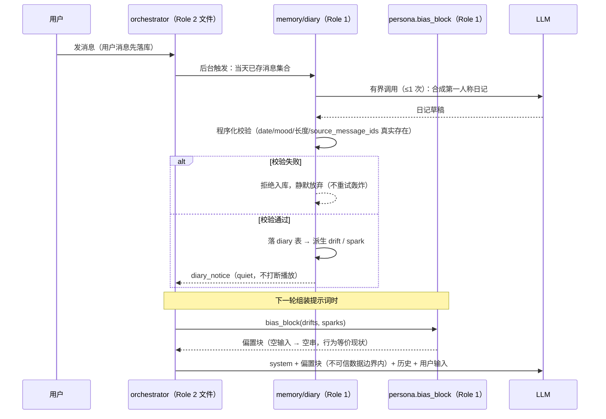
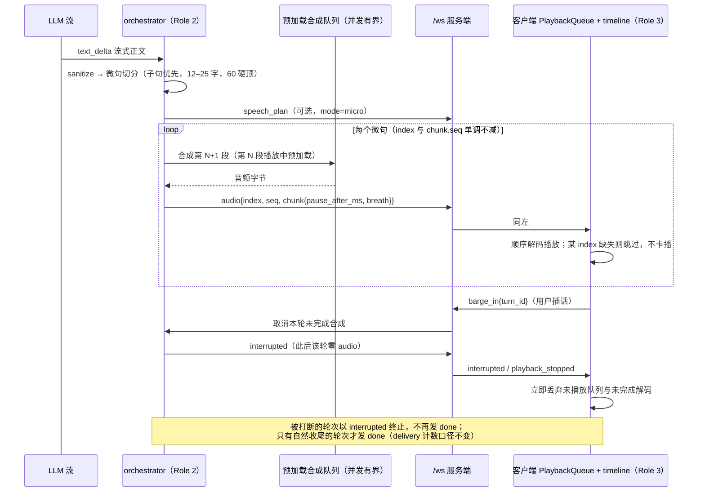
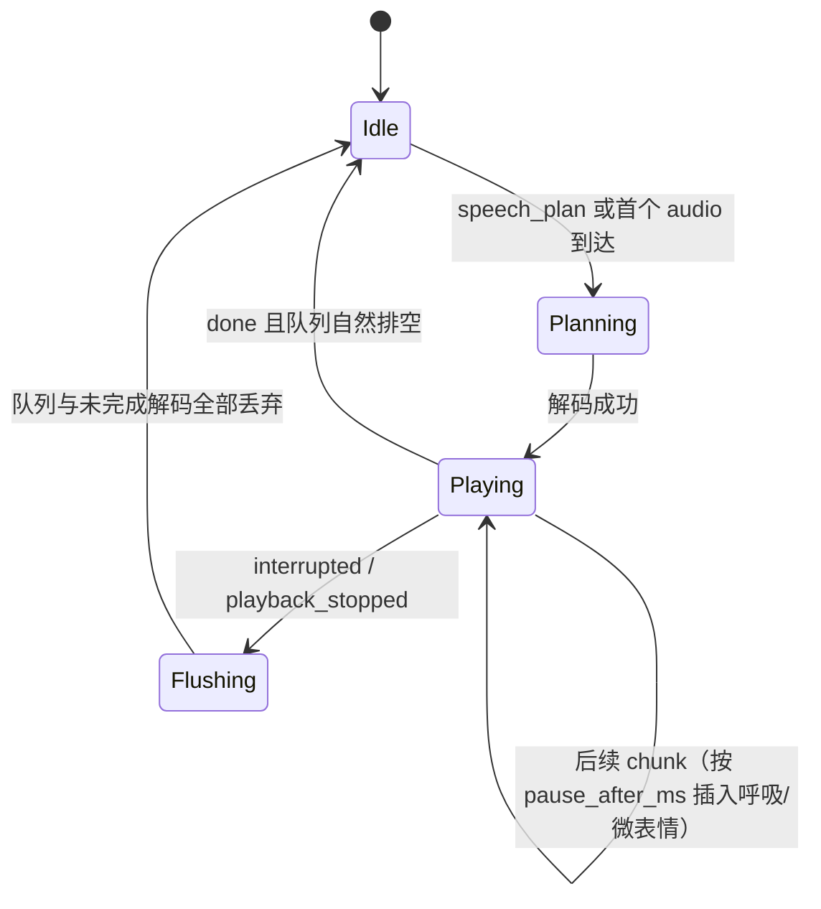
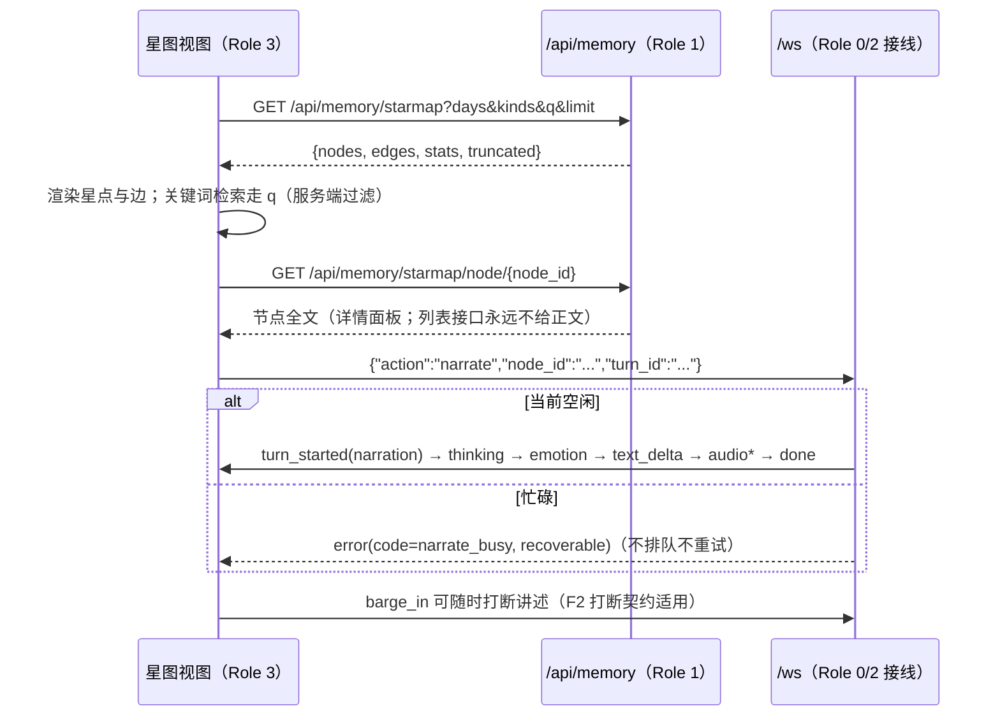

# WORKFLOWS — 第二阶段核心逻辑流

文字和 JSON Schema 说不清时序交互的地方，用图说。本文四张图对应 `PROTOCOL.md` 第十至十三节，**契约以协议为准，图只是帮助建立直觉**；图与协议冲突时改图。

## F1 日记合成与偏置注入



要点：日记永远慢一轮生效；`latent` 火花在 `surfaced` 前不出现在任何提示词或事件里。

## F2 长语音微句流与双工打断



客户端播放队列状态机：



## F3 后台自进化与主动开口

```mermaid
sequenceDiagram
    participant T as 空闲计时器
    participant Loop as assistant/loop 自治模式（Role 1）
    participant M as 记忆库 / self_state（Role 1）
    participant O as orchestrator 固定回复交付器（Role 2）
    participant C as 客户端
    T->>Loop: idle ≥ idle_minutes 且用户已授权主动发言
    Loop->>M: 读最近日记 / 记忆 / 好奇心种子
    Loop->>Loop: 有界复盘（模型调用数与状态变更数上限，全程 trace）
    Loop->>M: 更新 taste / worldview；latent → surfaced
    Loop-->>C: self_evolution（quiet，仅信息性）
    alt 到达主动开口窗口
        Loop->>O: 基于 taste/worldview/spark 生成一句话（≤120 字）
        O->>C: turn_started(self_topic) → thinking → emotion → text_delta → audio* → done
    else 冷静期 / 未授权 / 用户正忙
        Loop-->>Loop: 不开口，仅更新状态
    end
```

要点：自进化只写 `subject="self"`；拒绝关键词冷静期对 `self_topic` 同样生效。

## F4 星图检索与节点讲述


